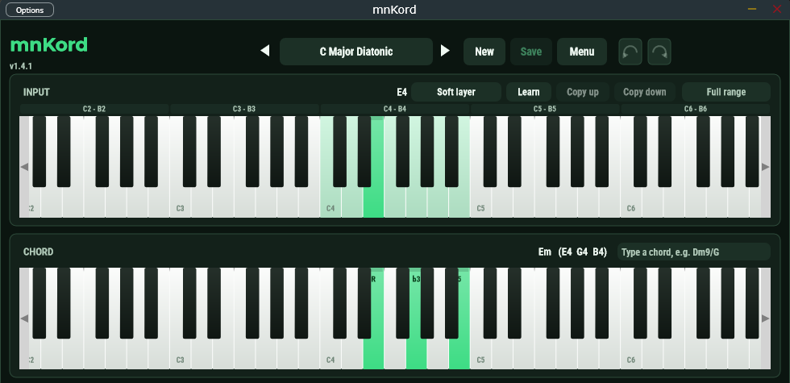
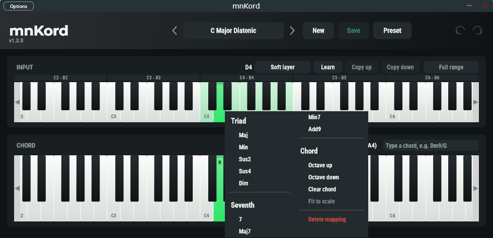
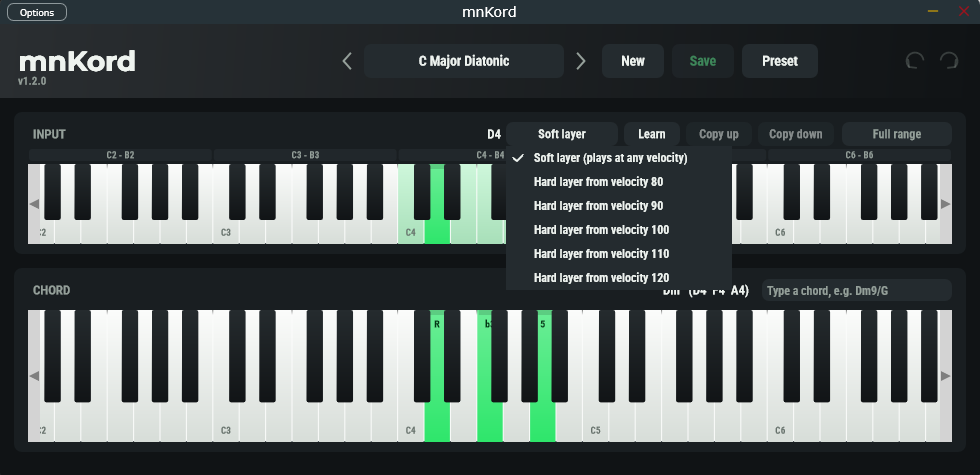
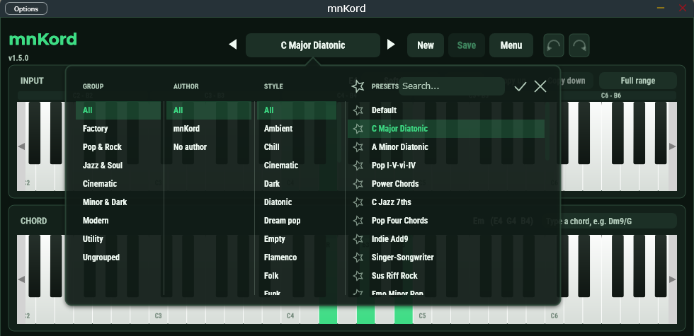
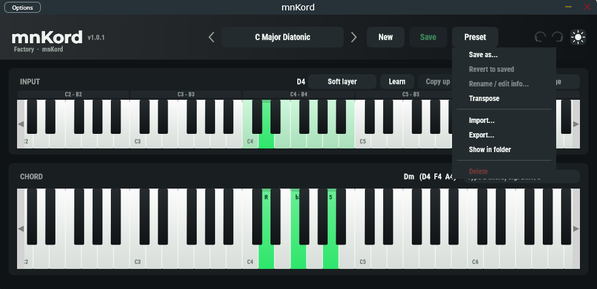

# mnKord felhasználói útmutató

[English](USER_GUIDE.md) · **Magyar** · [Dokumentáció kezdőlap](README.hu.md)

A mnKord egy MIDI-effekt: megnyomsz egy billentyűt, és egy egész akkordot küld. Hangot nem ad ki
magától. Tedd egy szintetizátor elé, és a szintetizátor játssza le az akkordokat.

```text
MIDI-billentyűzet  ->  mnKord  ->  szintetizátor
  (egy billentyű)      (leképezi)    (lejátssza az akkordot)
```

A program felületén angol feliratok vannak, ezért ez az útmutató is angolul írja a gombok és menük neveit.

## Telepítés

**Windows:** futtasd a `mnKord-<verzió>-win-x64-setup.exe` fájlt. A plugint (VST3) a
`C:\Program Files\Common Files\VST3\` mappába teszi, ahol minden DAW keresi a VST3 pluginokat. Ha a DAW nem
mutatja, indíts egy új pluginkeresést (rescan). A Standalone program nem része a telepítőnek.

Az útmutató (PDF) és a licencek a `C:\Program Files\Common Files\MNAudio\mnKord` mappába kerülnek, Start menü
parancsikonokkal. Új verziót a régi fölé is telepíthetsz: a telepítő kiírja a talált verziót ("Upgrade: v1.2.0 ->
v1.3.0"), visszalépés előtt rákérdez, és kéri a DAW bezárását, ha a mnKord be van töltve.

Eltávolítás: *Beállítások → Alkalmazások → mnKord → Eltávolítás*. A presetjeid (lásd lent) megmaradnak.

## Használat DAW-ban

1. Hozz létre egy **hangszersávot** (instrument track), és tedd rá a **mnKord**ot. (A mnKord VST3
   *hangszerként* jelenik meg, hogy a hosztok MIDI-t adjanak neki, és a MIDI-t tovább is engedjék. Egyes
   DAW-ok a hangszerek között listázzák.)
2. A szintetizátort, amelyiknek az akkordokat játszania kell, tedd **a mnKord után** ugyanarra a sávra
   (vagy kösd a mnKord MIDI-kimenetét a szintetizátor sávjára). Hogy ez pontosan hogyan megy, a DAW-tól függ:
   keress rá a "MIDI output" vagy "plugin chain" kifejezésre.
3. Játssz a billentyűzeteden. Amelyik billentyűhöz van akkord az aktuális presetben, az az akkordot játssza. A
   leképezés nélküli billentyű nem szól, minden más MIDI (pitch bend, moduláció, szusztain pedál, ...)
   változatlanul átmegy a szintetizátorra.

## Az ablak

| Terület | Mi ez |
|---------|-------|
| Fejléc | A mnKord felirat alatta a plugin verziójával, a preset neve **< >** nyilakkal, **New**, **Save**, **Preset** menü és **Undo / Redo**. A név utáni pont azt jelzi, hogy a presetnek mentetlen változásai vannak. |
| **INPUT** billentyűzet | A billentyűk, amelyeket játszol. Az akkorddal rendelkező billentyűk színesek. A billentyűk feletti sáv az oktávokat mutatja. |
| **CHORD** billentyűzet | A kiválasztott INPUT billentyű akkordjának hangjai. |
| Akkordnév-mező | Írj be egy akkordszimbólumot (`Dm9/G`, `Bbmaj7`, `C6/9`, ...), és az a kiválasztott akkord helyére kerül. Felette látod az akkord nevét és hangjait. |



### Akkord készítése

1. Kattints egy billentyűre az **INPUT** billentyűzeten. Ezzel kiválasztod.
2. Kattints a **CHORD** billentyűzet billentyűire, hogy hozzáadj vagy elvegyél hangokat az akkordból.

Gyorsabb módok:
- **Jobb kattintás egy INPUT billentyűn:** akkordsablonok (hármas- és szeptimhangzatok). Az a sablon, amelyik
  kilépne a kiválasztott skálából, szürke. A menüben van még *Octave up / down*, *Clear chord* és
  *Fit to scale*.
- **Írj be egy akkordszimbólumot** a CHORD billentyűzet feletti mezőbe, és nyomj Entert.
- **Jobb kattintás egy CHORD billentyűn:** az akkordot felfelé vagy lefelé megfordítja.
- **Learn:** nyomd meg a **Learn** gombot, és játssz egy billentyűt a kontrolleren. Kiválasztja a billentyű
  leképezését (vagy létrehozza).



### Akkordok másolása másik oktávba

Kattints egy oktávra az INPUT billentyűzet feletti sávban, majd a **Copy up** vagy **Copy down** gombra. Az
oktáv akkordjait egy oktávval feljebb vagy lejjebb másolja.


### Skála

A skála-gomb (amíg nem választasz, **Full range** áll rajta) a billentyűzetet egy skála hangjaira korlátozza
(dúr, moll, pentaton, ...), és az egész presetet kitölti a skála hármas- vagy szeptimhangzataival.

### Velocity-rétegek

Az INPUT billentyűzet feletti rétegmenü azt választja, melyik réteget szerkeszted:

- **Soft layer:** bármilyen erősséggel játszva szól.
- **Hard layer from velocity 80 / 90 / 100 / 110 / 120:** ugyanahhoz a billentyűhöz egy második akkord, amely
  helyette szól, ha legalább ilyen erősen ütöd le.

Így egy billentyű halkan egy sima hármashangzatot, erősen egy teltebb akkordot játszhat.



### Visszavonás

A leképezések minden szerkesztése visszavonható és újra végrehajtható a nyilakkal, vagy **Ctrl+Z** /
**Ctrl+Y** billentyűkkel.

## Presetek

A preset billentyű–akkord leképezések halmaza, névvel, csoporttal, szerzővel és stílus-címkékkel.

- A **gyári presetek** (kb. 30) csak olvashatók. Szerkeszd, és a **Save as** gombbal mentsd el a saját
  változatodat.
- A **saját presetjeid** fájlként mentődnek, és minden projekt és minden plugin-példány közösen használja őket.
- Kattints a preset nevére a **böngésző** megnyitásához: oszlopok a csoportnak, a szerzőnek és a stílusnak,
  keresőmező, és csillag a kedvencek jelölésére. Jobb kattintással betöltheted, duplikálhatod, átnevezheted,
  megnyithatod a mappáját vagy törölheted a presetet (a törölt fájlok a kukába kerülnek).
- A **Save** kiírja a változtatásokat. Ha mentetlen változásokkal hagyod el a presetet, a mnKord megkérdezi,
  menti-e őket. Gyári presetnél a válasz *Discard* vagy *Cancel* (előbb használd a *Save as*-t, ha meg
  akarod tartani).
- A **New** új presetet hoz létre. Kitöltheted egy skála akkordjaival (akkordméret, fordítás, oktáv és az
  egyes akkordszerepek velocity-je).
- A **Preset** menü: *Save as*, *Revert to saved*, *Rename / edit info*, **Transpose** (a billentyűk és az
  akkordok együtt, vagy csak az akkordok), *Import* (egy preset vagy egy teljes bank-fájl), *Export* és
  *Show in folder*.





A presetek a `Documents\MNAudio\mnKord` mappában vannak: a `Factory` mappát a plugin kezeli, a `User` mappában
vannak a saját presetjeid. Preseteket átmásolhatsz oda vagy onnan.

### Projektek

A DAW-projekt azt a presetet tárolja, amelyet használtál, **a pillanatnyi szerkesztéseivel együtt**, nem csak
egy hivatkozást rá. A projekt egy másik gépen is ugyanúgy szól, a presetjeid nélkül is. Ha a tárolt preset
eltér a könyvtárban lévőtől (például szerkesztetted, vagy egy későbbi verzió megváltoztatott egy gyári
presetet), mentetlenként jön vissza. A **Revert to saved** a könyvtár változatát tölti be, a **Save as**
megtartja a projekt változatát.

### Programváltás

A hoszt egy fix, 128 elemű programlistát lát: a presetek, utána "-" nevű üres helyek. A DAW programváltással
és automatizálással tud presetet váltani. A saját presetek megtartják a számukat, mert abban a sorrendben
maradnak, ahogy hozzáadtad őket.

## Standalone

A Standalone program (forrásból építhető, nem része a telepítőnek) DAW nélkül futtatja a mnKordot. Az
**Options** menüben (bal felül) választhatod ki a MIDI-bemenetet és -kimenetet, valamint a hangeszközt. A mnKord
MIDI-kimenetét küldd egy szintetizátorra, például virtuális MIDI-kábellel.

## Tippek és hibák

- **Nincs hang:** a mnKord nem ad hangot. Nézd meg, hogy van-e mögötte szintetizátor, és kap-e MIDI-t.
- **Egy billentyű nem szól:** nincs akkordja az aktuális presetben (ez szándékos, eldobja). Válaszd ki a
  billentyűt, és adj hozzá hangokat.
- **Beragadt hangok:** a transport leállítása és az "all notes off" elengedi a hangokat. Ha a szintetizátor
  mégis lógatna egy hangot, nyomd meg újra ugyanazt a billentyűt.
- **A preset nevén pont van:** mentetlen változásai vannak. Lásd fent: *Projektek*.
- **Hol van a plugin?** `C:\Program Files\Common Files\VST3\mnKord.vst3`. Indíts új pluginkeresést a DAW-ban.

## Billentyűk

| Billentyű | Hatás |
|-----------|-------|
| Ctrl+Z / Ctrl+Y | Visszavonás / újra |
| Enter az akkordmezőben | Az akkordszimbólum alkalmazása |
| Esc az akkordmezőben | A mező törlése |

## Licenc

A mnKord szabad szoftver a GNU Affero General Public License v3.0 alatt (lásd [LICENSE](../LICENSE)). A
mellékelt betűtípusok saját licencet követnek, ezek a [Resources/Fonts](../Resources/Fonts) mappában vannak.
